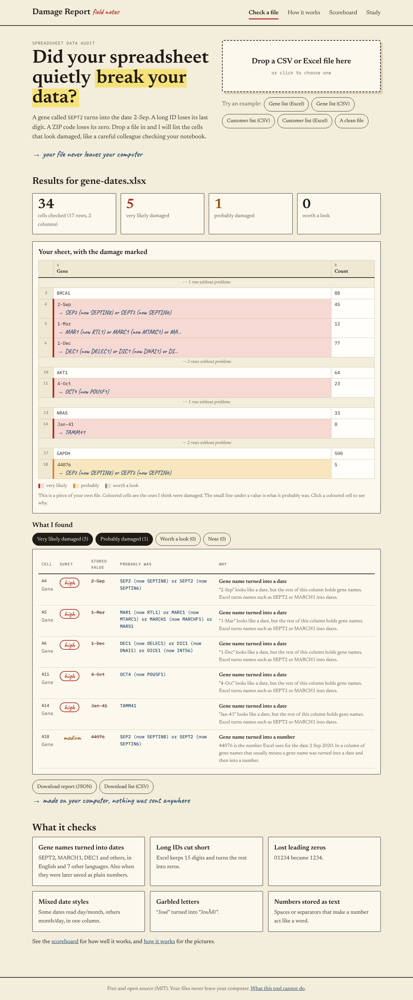
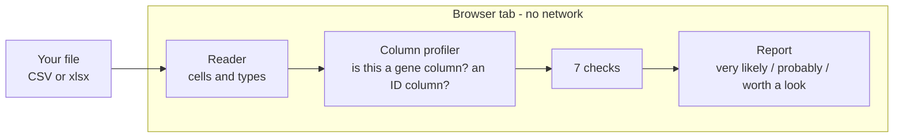
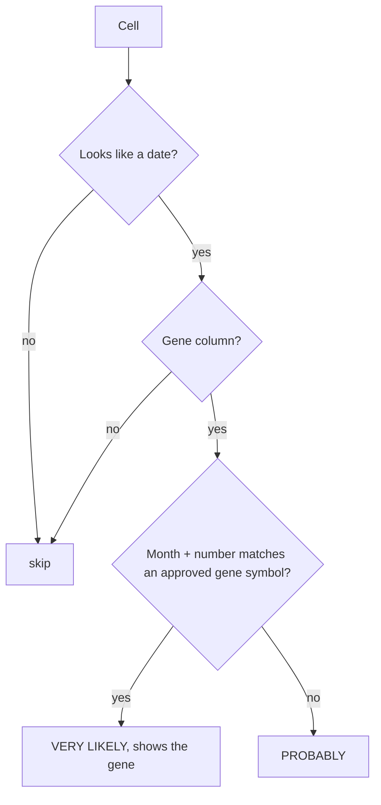
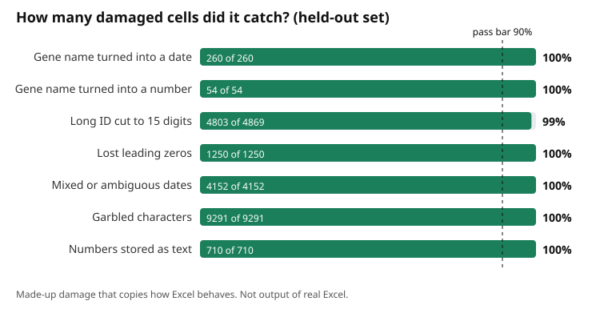
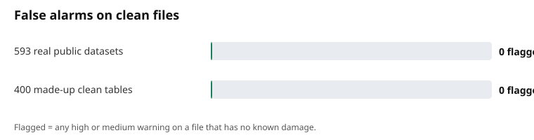

# Damage Report

**Drop a CSV or Excel file. Get a list of cells your spreadsheet software probably damaged.**
Runs entirely in your browser. Nothing is uploaded.

A gene called `SEPT2` becomes the date "2-Sep". A 16-digit ID loses its last digit. A ZIP code `01234` becomes `1234`.
Published research found gene-name errors in roughly 1 of 5 papers with gene lists. This tool finds that kind of damage.

## Try it

Full local guide: `LOCAL-TESTING.md`. Short version: `npm install && npm run local`.

`npm install && npm run dev`, then open the page and drop a file (or use the built-in examples).
Command line: `npm run scan -- myfile.xlsx`

Five Excel test files with notes on what to expect are in `examples/`.

## How it works

The 7 checks: gene name → date, gene name → number, long ID cut to 15 digits, lost leading zeros,
mixed date styles, garbled characters, numbers stored as text.

More pictures: the site's "How it works" page.

## How well does it work?

First `pip install pydataset && python3 -I scripts/make-real-data.py` (makes the 593 real test files; they are not stored in git), then run `npm run bench`. Pass bars were fixed before the first run. See `docs/scoreboard.json`.
Honest history: the first run exposed a wrong damage emulator and a bar I had to explain; a real-data check found
one false alarm (movie titles like "06"), which was fixed and given a regression test.

## Fixing the damage

After a check, press **Prepare the fixes**. Every damaged cell ends in one of four boxes:

| Box | Meaning | Example |
|---|---|---|
| Fixed with proof | One right answer, and the reason is shown. On by default; one click turns it off. | `4-Oct` can only be `OCT4` (now `POU5F1`). A cut 16-digit ID gets its check digit back. A barcode gets its zeros back because only then does the check digit work. A ZIP gets its zero back because the State column says MA. |
| Fixed by your choice | More than one answer, or a change that needs your yes. Nothing happens until you decide. One decision settles all identical cells. | `1-Mar` could be `MARCH1` or `MARC1`. A date written in the other order. A phone number that lost a zero. |
| Find it at the source | The missing part is not in the file. It goes on a recovery list with what is still reliable. | A 16-digit ID cut to 15 digits with no check digit to rebuild it. A sheet that ends exactly at Excel's row limit. |
| Locked away safely | Really lost, or a formula cell. Left as it is and flagged. | A letter already replaced by `�`. |

Clues the fixer uses: the official gene-name list, the date format stored in the Excel cell (a cell shown as `d-mmm` holds a day, `mmm-yy` holds a year), the 1900/1904 date system, Luhn, barcode (GS1) and ISBN-10 check digits, the State column for US ZIP codes, and a whole-column vote for European number style (`1.234,56`). Numbers above 9,007,199,254,740,992 are ignored as evidence, because a spreadsheet number cannot hold their last digits exactly.

Two downloads for Excel files:

- **Fixed Excel file**: your own file with only the fixed cells edited. Colours, column widths, formulas, charts and other sheets stay byte-for-byte as they were. Fixed IDs and codes become text cells.
- **Clean copy**: a new file made from the values, with the change log and recovery list as extra sheets. It does not keep colours, widths or charts, and formulas become values.

Also: fixed CSV (UTF-8 mark so Excel reads accents, original delimiter kept, title lines kept), change log (CSV), recovery list (CSV), audit report (HTML). Your original file is never changed.

Rules the code follows (tested in `tests/fix.test.ts`, `tests/workbooks.test.ts`, `tests/adversarial.test.ts`):

- A cell that was not flagged is **never** changed. The export stops with an error if that ever fails.
- Gene names: you choose whether the name comes back as typed (`SEPT2`) or as the approved name today (`SEPTIN2`). The change log shows both.
- A gene whose month word is in another language (French `MARS1`) is offered as a labelled choice, never as proof, because it only fits an Excel in that language.
- Files that are not UTF-8 are read as Windows-1252 and you are told. Title lines above a table are skipped to find the real header.

**Fix test** (`npm run fixbench`, synthetic damage, 2 seeds x 400 tables, bars set before the first run): 0 clean cells broken, 0 wrong "proven" fixes out of about 11,000, and the right answer always among the options. With proven fixes only, about 45% of the wrong cells remain; after you answer the choices, about 17-24% remain (those are cut-off IDs that need the source). All choices together need about one decision per damaged table, because identical cells are settled together.

**Real-file tests** (`python3 scripts/make-test-workbooks.py`, `python3 scripts/make-adversarial.py`, then `npm test`): Excel files written by openpyxl and LibreOffice, with barcodes, ZIPs, formulas, two date systems, title rows, hidden sheets, errors and 40,000-character cells. Every patched file is opened by LibreOffice. A 120,000-row file is analysed and prepared in about 4 seconds while the page stays responsive.

Not built, on purpose: a small AI model. The tests show no need: the right answer was among the options every time, and the rules can explain every fix. It would only be added if real files proved otherwise. Also not built: ZIP checks for countries other than the US, postal lookups by city, learning from your clicks across files.

## Licences

| Part | Licence |
|---|---|
| This project's code | MIT (see `LICENSE`) |
| Gene-name data (`src/data/genes.json`) | The facts come from **HGNC**, released under **CC0** (public domain, "any form of reuse of the content is permitted"). Attribution is requested, not required: *HGNC (RRID:SCR_002827)*, genenames.org. |
| How the current `genes.json` was obtained | Built from the official **HGNC complete set** (`hgnc_complete_set.txt` from genenames.org, released under **CC0**) with `npm run genes -- --hgnc hgnc_complete_set.txt`. Nothing in this repo depends on the GPL package HGNChelper any more. Mixed-case aliases in that file (Oct4, Mar1) are stored in capitals, the way people type gene names. Rebuild any time to pick up newer names. |
| Fonts (Newsreader, Caveat, IBM Plex Mono) | SIL Open Font License 1.1, via `@fontsource` |
| Test data in `testbench/real/` | Public R datasets through `pydataset`, not shipped in the zip. See `DATA-NOTICE.md` |

Credit line used on the site: *Gene symbols: HGNC, genenames.org (CC0).*

## Limits (read these)

- The damaged test files are made up to imitate Excel. No real Excel was available. Real-world scores will be lower.
- Real public files (593) were used only to test false alarms, not catching.
- Plain CSV cannot prove damage. Many CSV findings are "probably".
- Lost digits cannot be recovered. The fixer rebuilds them only when a check digit proves it, otherwise they go on the recovery list.
- The fix step has never been run on a file damaged by real Excel, only on imitations and on files written by openpyxl and LibreOffice. The patching is verified by opening the result in LibreOffice, not in Excel.
- ZIP-by-state evidence covers the US only. Other countries' ZIP or phone rules are not built.
- Excel files that are encrypted, `.xls`, or `.xlsb` are not read.
- `.xls` is not supported. The xlsx reader is tested on openpyxl and LibreOffice files only.
- The gene list is a snapshot; see `DATA-NOTICE.md` about licence before you publish.
- The Zenodo downloader in `scripts/study.ts` has not been tested against the live site, so there is no headline study number yet.

## Commands

| Command | What it does |
|---|---|
| `npm run dev` | Local site |
| `npm run fixbench` | The fix test: broken clean cells, wrong proven fixes, errors before and after |
| `npx tsx scripts/fix-file.ts in.xlsx out.xlsx` | Apply the proven fixes from the command line |
| `python3 -I scripts/make-test-workbooks.py` | Make the realistic damaged test workbooks |
| `npm test` | Unit tests |
| `npm run bench` | Scoreboard and charts |
| `npm run build` | Build the site into `dist/` |
| `npm run e2e` | Real-browser tests (needs a build and Playwright) |
| `npm run scan -- file` | Check files from the terminal |
| `npm run study -- folder` | Scan a folder and summarise |

## Publish on GitHub Pages

Push to `main`. In the repo settings choose Pages → Source: GitHub Actions. `pages.yml` tests, builds and deploys.

MIT licence (code). Data notice in `DATA-NOTICE.md`.
